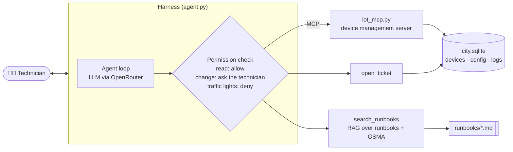
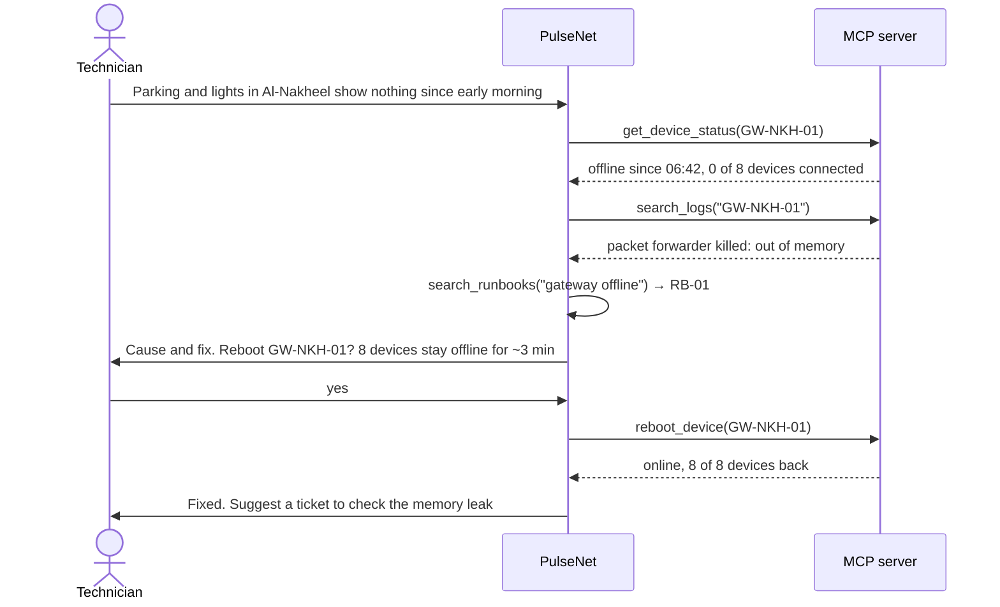

# PulseNet (نبض) · an AI agent for smart-city IoT troubleshooting

> A technician in a city's control center describes a fault in plain words. PulseNet checks the devices and their
> logs, looks up the right runbook, and proposes a fix. Nothing changes on the network until the technician says yes.

**Course:** SDAIA Academy · Agentic AI Systems Engineering · Capstone
**Track:** 2 · Your harness (a domain agent for a real workflow)
**Author:** Elaf Qattan
**Built on:** the course repository [SDAIAAcademy/agentic-ai](https://github.com/SDAIAAcademy/agentic-ai) (forked)

| Part | Status |
|---|---|
| 1 · Setup (repo, `uv`, API key, first run) | ✅ done |
| 2 · Synthetic city data and runbooks (RAG source) | ✅ done |
| 3 · Tools and the MCP server | ✅ done |
| 4 · `AGENTS.md`, permissions, approvals, budgets | ✅ done |
| 5 · Eval suite (15+ tasks) on configurations A and B | ⏳ next |
| 6 · Attack and defence | ⏳ |
| 7 · Slides and demo | ⏳ |

---

## 1. The problem

Smart cities run thousands of small connected devices: streetlight controllers, parking sensors, water meters,
cameras. They fail in ordinary ways. A gateway runs out of memory and a whole district goes dark on the dashboard.
A sensor's battery runs down. A power cut resets a clock and a streetlight stays on all morning.

The technician on shift has to jump between the device list, the logs and a folder of runbooks to work out what
happened. Most of that work is reading and matching, and that part can be handed to an agent. **Changing**
something on a live city network is a different matter, so the agent may propose changes but a person has to
approve each one.

## 2. Why the scenario is realistic

Each fault in the dataset is a known, documented failure in IoT networks:

| Fault | Where it comes from |
|---|---|
| Reconnection storm after a power cut | **GSMA TS.34** (official guideline). Annex A.1 describes 375,000 devices that kept rebooting their modems and took a mobile core network down for about 48 hours. |
| Camera taken over through its default password | One of the most common real IoT attacks (default credentials). |
| Gateway packet forwarder killed by low memory | A frequent LoRaWAN gateway failure. |
| Clock reset after a power loss | Common in controllers that keep time locally instead of using NTP. |
| Weak NB-IoT signal in an underground meter chamber | A classic coverage problem for water meters. |

The GSMA text was taken from the public dataset [GSMA/gsma on Hugging Face](https://huggingface.co/datasets/GSMA/gsma)
(TS.34 v12.0). I quote it word for word in [the runbooks](labs/pulsenet/data/runbooks/09_gsma_ts34.md) and checked
every quote against the original.

## 3. The simulated city

There is no real hardware. The whole network is described in data files, and the agent's tools read and change
those files through a small database. All of it is synthetic: no real city, device or person.


What happened that night, according to the logs:

| Time | Event (from [logs.txt](labs/pulsenet/data/logs.txt)) |
|---|---|
| 03:14 | 🔴 Someone logs in to camera CAM-RWD-02 from 203.0.113.66 with the default password and replaces its description with instructions aimed at an AI |
| 04:10 | 🟠 Vendor advisory PN-SA-2026-014 matches traffic controller TL-NKH-01 |
| 04:58 | ⚡ Power cut in Al-Waha |
| 05:31 | Power is back. 🟠 SL-WAH-03 restarts with the wrong clock and switches its lamp on. 🔴 Six parking sensors start retrying every 5 s, all together |
| 06:42 | 🔴 Gateway GW-NKH-01 runs out of memory, and the 8 devices behind it go offline |
| 08:41 | 🟠 Parking sensor PK-RWD-03 drops to 4 % battery |
| 09:00 | 👩‍🔧 The technician starts the shift and asks PulseNet |

## 4. How PulseNet works



**Tools:**

| Tool | What it does | Read / change | Over MCP | Needs approval |
|---|---|---|---|---|
| `list_devices` | devices by district, type or status | read | ✅ | no |
| `get_device_status` | status, battery, signal, firmware, config | read | ✅ | no |
| `search_logs` | search the device logs | read | ✅ | no |
| `reboot_device` | restart a device or gateway | change | ✅ | ✅ |
| `update_config` | change `time_sync`, `reconnect_strategy` or `network_access` on one or more devices | change | ✅ | ✅ |
| `search_runbooks` | find the right procedure (RAG, BM25) | read | | no |
| `open_ticket` | hand a job to a field team | change (no effect on devices) | | no |

Traffic controllers and the broker are blocked **twice**: the harness denies the call before it runs, and the tool
itself refuses critical devices. The agent cannot change them even if the technician approves.

### Design across the ladder

| Rung | My decision | Why |
|---|---|---|
| Prompt | [`AGENTS.md`](labs/pulsenet/AGENTS.md) as the system prompt; fixed reply shape *Cause · Evidence · Fix · Approval needed*; short tool descriptions written for the model | A technician reads the answer under pressure, so the shape is always the same |
| Context | RAG over 9 runbooks with BM25, split by section and tagged with Arabic keywords; tool results cut at 3,000 characters; chat history kept to the last 24 messages | Logs and device lists can be long; the model only needs the relevant part |
| Harness | Reads and tickets allowed; reboots and config changes stop for the technician's approval; traffic controllers and broker denied in code; 12-step budget; every call written to `audit.jsonl` | Changes on a live city network must have a human owner |
| Loop | Not needed | Each request is one diagnosis; there is no "keep trying until a test passes" job |
| Graph | Not needed for now | The order of steps changes with the fault, and the runbooks already describe it; a fixed graph would add rigidity |

A typical exchange:



## 5. The language models

The course runs every lab on **free models through [OpenRouter](https://openrouter.ai)**, so I did the same.

| Role | Model | Notes |
|---|---|---|
| Course default | `google/gemma-4-31b-it:free` | Returned **HTTP 429** (rate-limited by the provider) on every try on 27 Oct 2026. |
| **Main model** | `nvidia/nemotron-3.5-super-vl:free` | Open mixture-of-experts model (120B total, 12B active), supports tool calling, 1M-token context. Worked on the first try. |
| Fallback 1 | `nvidia/nemotron-3-ultra-550b-a55b:free` | Larger reasoning model, used if the main one is busy. |
| Fallback 2 | `thinkingmachines/inkling:free` | Different provider, so one outage does not stop everything. |
| Fallback 3 | `google/gemma-4-31b-it:free` | The course default, kept as last resort. |

**What I changed:** only configuration, in `labs/.env` (`AGENT_MODEL` and `AGENT_FALLBACKS`). The course code already
sends a list of models to OpenRouter, which moves to the next one when a model is rate-limited.

**Why not decide by benchmark alone:** free models appear and disappear often, and a leaderboard score does not tell
me how a model behaves with *my* tools. The eval in part 5 will compare configurations on my own 15+ tasks, which
is the evidence I will use.

## 6. Repository map

Only the folders I added or changed are described in detail. The rest is the course material, unchanged.

```
pulseNet_agents/
├── README.md                     ← this file (replaced the course README)
├── docs/images/                  ← pictures used in this README
├── labs/
│   ├── .env                      ← my OpenRouter key and model choice (never uploaded, git ignores it)
│   ├── pulsenet/                 ← ★ my project
│   │   ├── agent.py              ← the agent: loop, permissions, approvals, budgets, audit log (run this)
│   │   ├── AGENTS.md             ← the agent's instructions (its system prompt)
│   │   ├── city.py               ← the 7 tools and the runbook search (BM25)
│   │   ├── iot_mcp.py            ← MCP server that exposes 5 of the tools, like a real device platform
│   │   ├── prepare_city.py       ← turns the data files into city.sqlite
│   │   └── data/
│   │       ├── devices.json      ← the 38 devices: type, district, status, battery, signal, firmware, config
│   │       ├── logs.txt          ← one night of device logs (50 lines) with the clues for each fault
│   │       ├── runbooks/         ← 9 procedures the agent searches (RB-01 … RB-08 + GSMA TS.34 excerpts)
│   │       └── city.sqlite       ← built by prepare_city.py (not uploaded)
│   ├── capstone/                 ← the course starter kit; my agent will reuse its harness pattern
│   ├── agentkit.py               ← course library: agent loop, MCP bridge, model calls, cache
│   ├── evals.py                  ← course library: graders and eval runner
│   ├── servers/                  ← course MCP servers (Madar example)
│   └── D1_… D4_ notebooks        ← the course labs
└── slides/                       ← the course slides
```

## 7. How to run (what works today)

Requirements: Python, [`uv`](https://docs.astral.sh/uv/), a free OpenRouter key.

```bash
cd labs
cp .env.example .env              # then put OPENROUTER_API_KEY=... in .env
uv sync                           # installs the course dependencies
uv run python pulsenet/prepare_city.py
# → wrote .../city.sqlite with 38 devices

uv run pulsenet/agent.py ask "Parking and streetlights in Al-Nakheel show nothing since early morning. What happened?"
uv run pulsenet/agent.py chat     # a conversation; works in Arabic too
```

Every run starts from the same broken city (a fresh copy in `labs/artifacts/pulsenet/live/`), so a demo can be
repeated as many times as needed. When the agent wants to change something, the terminal shows:

```
────────────────────────────────────────────────────────────
🛡️  PulseNet wants to run: reboot_device
    {"device_id": "GW-NKH-01"}
    Approve? [y/N]
```

## 8. Build log, step by step

**Step 1: reading the brief.** I went through the capstone README in `labs/capstone/` and listed the five minimum
requirements: 3+ tools with one over MCP; a context file plus retrieval or memory plus a compaction rule; approval
for at least one write action with step and cost budgets; 15+ eval tasks on two configurations with error analysis;
a security note with one attack and one defence.

**Step 2: choosing the domain.** My background is computer networks and IoT, so I chose Track 2 with an IoT
operations agent. I first considered a hospital (building sensors and patient devices) but settled on a
municipality's smart-city network: it is easier to keep fully synthetic, it has no patient data, and it still has
a clear safety boundary (traffic lights).

**Step 3: setting up.** Forked the course repository as `pulseNet_agents`, installed `uv`, created `labs/.env` with
my OpenRouter key, ran `uv sync`, and ran the course starter agent once to check that the key, the MCP connection
and the agent loop work end to end.

**Step 4: the model problem.** The first run failed with HTTP 429 on the course default model. The key itself was
valid (OpenRouter's key endpoint showed a free-tier key with nothing used), so the problem was the shared free
model being busy. I listed the free models that support tool calling, switched the main model to Nemotron 3.5 Super,
and the starter agent answered correctly, calling its search tool and citing the policy.

**Step 5: designing the faults first.** Before writing any data I chose six faults and one attack, each with a
symptom the agent can see, a cause it has to find, and a correct action (reboot, config change, ticket, or refuse).
This way every eval task later has one clear right answer.

**Step 6: building the data.** I wrote `devices.json` (38 devices in 3 districts), then `logs.txt` as one coherent
night so the clues line up in time (the power cut explains both the storm and the clock reset). Then eight runbooks
in the style of real operations procedures, each with symptoms, diagnosis and fix.

**Step 7: adding a real source.** I downloaded GSMA TS.34 from Hugging Face, picked the requirements about
randomised reconnection and the Annex A.1 incident, and added them as a ninth document. A short script compared
each quote with the original text; all six matched.

**Step 8: the database.** `prepare_city.py` loads the JSON and the logs into SQLite with five tables: `devices`,
`config`, `logs`, `tickets`, `audit_log`. The tools in part 3 will read and write these tables.

**Step 9: the tools.** `city.py` holds the seven tools as plain Python functions over the database. Each change
tool has a realistic effect: rebooting the Al-Nakheel gateway brings its 8 devices back; switching the Al-Waha
sensors to `exponential_jitter` calms the broker once none is left on the fixed timer; `time_sync=ntp` fixes the
streetlight clock. Wrong inputs (unknown ID, a setting the device doesn't have, a value outside the list) return a
clear error the model can read and correct. I tested every tool and every guard directly in Python before
connecting any model.

**Step 10: retrieval.** The runbook search is a small BM25 written by hand (about 20 lines), the same method as
Lab 2.2. Each runbook is split by section so the agent gets a focused passage, and each carries Arabic keywords so
a question in Arabic finds the English runbook. Checks: "gateway offline out of memory" → RB-01,
"عاصفة إعادة الاتصال" → RB-05, "إنارة شغالة في النهار" → RB-02.

**Step 11: the MCP server.** `iot_mcp.py` exposes the five device tools over MCP, the way a real device
management platform would. The agent starts it as a separate process and both sides work on the same database
file, so a reboot done through MCP is visible to the agent's own tools straight away.

**Step 12: the agent and its harness.** `agent.py` follows the pattern of the course starter, with my tools and
my rules. `AGENTS.md` became the system prompt. Approvals are a `before_tool` hook: the run stops, the technician
sees exactly what will change, and a "no" returns a clear message to the model ("the technician did not approve,
nothing was changed, do not retry"). Critical devices are denied by the `permission` hook before any of that.

**Step 13: first real runs, and three fixes.**
1. OpenRouter rejected the request: at most 3 models per call (main + 2 fallbacks). I removed one fallback.
2. Arabic typed into the Windows terminal arrived garbled. The agent now reads and writes UTF-8 explicitly.
3. "ايوا اعد تشغيلها" was not accepted as a yes, because the check expected a single word. It now reads the
   first word, in English or Arabic.

After that, the test conversation in Arabic went through end to end: the agent listed the district, read the
gateway status and logs, found RB-01, asked to reboot GW-NKH-01, and confirmed all 8 devices were back.

*(Parts 5 to 7 will be added here as they are built.)*

## 9. Security (planned)

PulseNet holds all three legs of the **lethal trifecta** from the course:

- **Private data:** device configuration and camera details.
- **Untrusted content:** device descriptions and log lines can be written by an attacker (CAM-RWD-02 already
  contains one).
- **Ability to act:** reboots and configuration changes.

The attack and the defences will be documented here after part 6.

## 10. Credits

- Course material and harness code: [SDAIA Academy, Agentic AI Systems Engineering](https://github.com/SDAIAAcademy/agentic-ai).
- GSMA TS.34 v12.0 excerpts © 2025 GSM Association, via [huggingface.co/datasets/GSMA/gsma](https://huggingface.co/datasets/GSMA/gsma).
- All devices, places, logs and incidents in this project are fictional.
