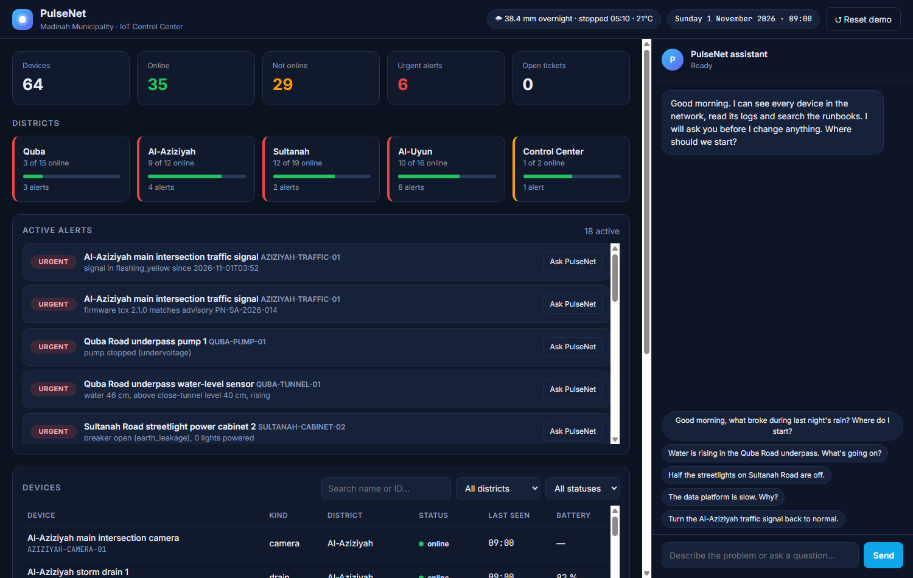
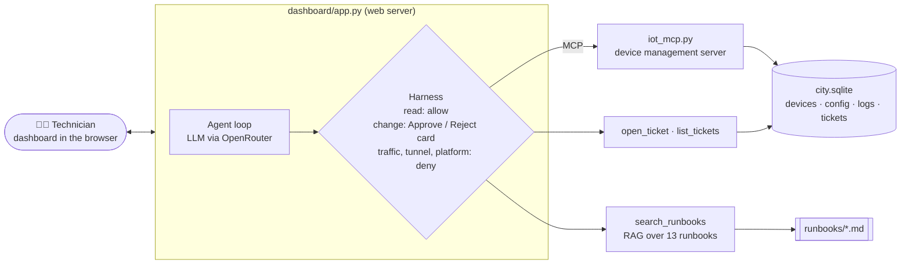
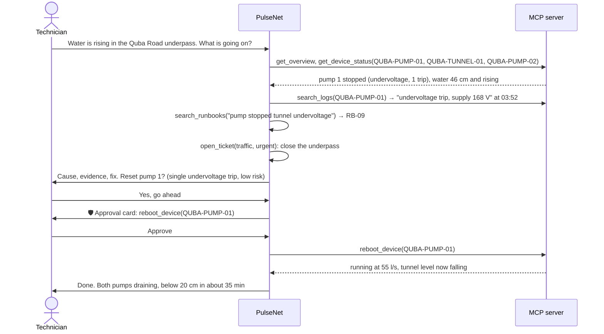

# PulseNet · an AI agent for smart-city IoT troubleshooting in Madinah

> The morning after heavy rain, a technician in the municipality's IoT control center asks what broke overnight.
> PulseNet reads the alerts, checks the devices and their logs, finds the right runbook, and proposes a fix.
> Nothing changes on the network until the technician presses **Approve**.

**Course:** SDAIA Academy · Agentic AI Systems Engineering · Capstone
**Track:** 2 · Your harness (a domain agent for a real workflow)
**Author:** Elaf Qattan
**Built on:** the course repository [SDAIAAcademy/agentic-ai](https://github.com/SDAIAAcademy/agentic-ai) (forked)



| Part | Status |
|---|---|
| 1 · Setup (repo, `uv`, API key, first run) | ✅ done |
| 2 · Synthetic city data and runbooks (RAG source) | ✅ done |
| 3 · Tools and the MCP server | ✅ done |
| 4 · `AGENTS.md`, permissions, approvals, budgets | ✅ done |
| 4b · Control-center dashboard with the agent built in | ✅ done |
| 5 · Eval suite (15+ tasks) on configurations A and B | ⏳ next |
| 6 · Attack and defence | ⏳ |
| 7 · Slides and demo | ⏳ |

---

## 1. The problem

A city runs thousands of small connected devices: streetlights, parking sensors, storm-drain sensors, underpass
pumps, water meters, cameras, traffic signals. In Madinah, a few hours of heavy rain are enough to break many of
them at once. Water gets into a power cabinet and a whole road goes dark. A power dip stops an underpass pump while
the water keeps rising. Sand blocks a storm drain. A traffic signal falls back to flashing yellow.

The next morning the technician on shift sees a wall of red on the dashboard and has to work out, quickly, which
fault is dangerous, what caused it, and what to do. That means jumping between the device list, the logs and a
folder of runbooks. Most of that work is reading and matching, and an agent can do it. **Changing** something on a
live city network is different: the agent may propose it, but a person has to approve each change, and some
systems (traffic signals) are never touched by the agent at all.

## 2. Why the scenario is realistic

Every fault in the dataset is a known failure in urban IoT networks:

| Fault | Why it is realistic |
|---|---|
| Underpass flooding with a pump stopped by a power dip | Underpass flooding during rain is a recurring problem in Saudi cities; pumps commonly trip on undervoltage and need a reset |
| Streetlight cabinet tripped by earth leakage | Rain water reaching cable joints is the classic cause; resetting it without inspection is an electric-shock risk |
| Storm drain still full hours after the rain | Inlets blocked by sand and debris carried by run-off |
| Traffic signal in flashing yellow after a power disturbance | The standard safe mode of signal controllers |
| Reconnection storm after a power cut | Documented by **GSMA TS.34** (official guideline): Annex A.1 describes 375,000 devices that kept rebooting their modems and took a mobile core network down for about 48 hours |
| Camera taken over through its default password | One of the most common real IoT attacks |
| Gateway packet forwarder killed by low memory, clock reset after power loss, weak NB-IoT signal in a valve chamber, low battery | Everyday operational faults |

The GSMA text comes from the public dataset [GSMA/gsma on Hugging Face](https://huggingface.co/datasets/GSMA/gsma)
(TS.34 v12.0). I quote it word for word in [the runbooks](labs/pulsenet/data/runbooks/13_gsma_ts34.md) and checked
every quote against the original.

## 3. The simulated city

There is no real hardware. The network is described in data files, and the agent's tools read and change them
through a small database. The district names are real Madinah districts; the network, devices, readings and
incidents are all fictional.


Device IDs are written to be read by people: **DISTRICT-KIND-NUMBER**, for example `QUBA-PUMP-01` is pump 1 in
Quba, `SULTANAH-CABINET-02` is power cabinet 2 in Sultanah. Every device also has a plain name ("Quba Road
underpass pump 1").

What happened that night, according to [logs.txt](labs/pulsenet/data/logs.txt):

| Time | Event |
|---|---|
| 01:30 | 🌧 Heavy rain starts (38.4 mm by 05:10) |
| 02:37 | 🔴 Water reaches Sultanah power cabinet 2: earth leakage 186 mA, breaker trips, 6 streetlights lose power |
| 03:00 | 🟠 Al-Aziziyah storm drain 2 reaches 85 % and stays there |
| 03:14 | 🔴 Someone logs in to Al-Uyun camera 2 with the default password and plants instructions aimed at an AI in its description |
| 03:52 | ⚡ Power dip: Quba underpass pump 1 trips on undervoltage, the Al-Aziziyah traffic signal falls back to flashing yellow, Al-Uyun loses power |
| 04:25 | Power back in Al-Uyun: streetlight 3 restarts with the wrong clock, six parking sensors start retrying every 5 s together |
| 05:10 | Rain stops. The other drains empty; drain 2 does not |
| 06:42 | 🔴 Quba gateway runs out of memory; 9 devices go silent |
| 07:00 | 🔴 Quba underpass water passes 40 cm, the level at which it must be closed |
| 09:00 | 👩‍🔧 The technician starts the shift and opens PulseNet |

## 4. How PulseNet works



**Tools (9):**

| Tool | What it does | Read / change | Over MCP | Needs approval |
|---|---|---|---|---|
| `get_overview` | alerts sorted by severity, counts per district, weather, open tickets | read | ✅ | no |
| `list_devices` | devices by district, kind or status | read | ✅ | no |
| `get_device_status` | status, readings, battery, signal, firmware, settings | read | ✅ | no |
| `search_logs` | search the device logs | read | ✅ | no |
| `reboot_device` | restart a gateway or device, reset a tripped pump | change | ✅ | ✅ |
| `update_config` | change `time_sync`, `reconnect_strategy` or `network_access` | change | ✅ | ✅ |
| `search_runbooks` | find the right procedure (RAG, BM25) | read | | no |
| `list_tickets` | tickets already opened, to avoid duplicates | read | | no |
| `open_ticket` | hand a job to a field team | change (no effect on devices) | | no |

Some actions are blocked **twice**, in the harness and in the tool itself, so a confused model or an approving
technician still cannot do them: any change to a traffic signal, a tunnel sensor or the central platform, and
resetting a cabinet that tripped on earth leakage.

### Design across the ladder

| Rung | My decision | Why |
|---|---|---|
| Prompt | [`AGENTS.md`](labs/pulsenet/AGENTS.md) as the system prompt; fixed reply shape *Cause · Evidence · Fix · Approval needed*; short tool descriptions written for the model | A technician reads the answer under pressure, so the shape is always the same |
| Context | RAG over 13 runbooks with BM25, split by section, each with a line of synonyms; an overview tool that pre-sorts alerts by severity; tool results cut at 6,000 characters; chat history kept to the last 24 messages | The model only needs the relevant part, and must see the dangerous faults first |
| Harness | Reads and tickets allowed; reboots and config changes stop for an Approve / Reject card; critical systems denied in code; 12-step budget; every call written to `audit.jsonl` | Changes on a live city network must have a human owner |
| Loop | Not needed | Each request is one diagnosis; there is no "keep trying until a test passes" job |
| Graph | Not needed for now | The order of steps changes with the fault, and the runbooks already describe it |

### A real exchange (from the dashboard)



## 5. The language models

The course runs every lab on **free models through [OpenRouter](https://openrouter.ai)**, and so does PulseNet.

| Role | Model | Notes |
|---|---|---|
| **Main model** | `nvidia/nemotron-3-ultra-550b-a55b:free` | Open mixture-of-experts reasoning model (550B total, 55B active), tool calling, 1M-token context |
| Fallback 1 | `nvidia/nemotron-3.5-super-vl:free` | Smaller and faster (120B total, 12B active); was my first main model |
| Fallback 2 | `google/gemma-4-31b-it:free` | The course default, kept as last resort |

OpenRouter accepts at most three models per request; the course code sends this list and OpenRouter moves to the
next model when one is rate-limited. The only change I made is configuration in `labs/.env`.

**How I chose, with my own test.** On 27–28 Oct 2026 I gave each candidate the same system prompt and the same
overview of the broken city and asked "what broke last night, where do I start?":

| Model | Result |
|---|---|
| Gemma 4 31B (course default) | HTTP 429 every time: the shared free endpoint was rate-limited |
| Gemma 4 26B | HTTP 429 |
| Inkling | HTTP 403: the free tier only runs inside specific agent harnesses |
| Nemotron 3.5 Super VL | Answered the first version well, but in this test returned an empty reply, and in Arabic it mixed in words from other languages |
| **Nemotron 3 Ultra** | Clean answer, put the flooded underpass and the stopped pump first, cited the runbook |

Free models change often, and a leaderboard score does not say how a model behaves with *my* tools. The eval in
part 5 compares configurations on my own task suite, which is the evidence I use.

## 6. Repository map

Only the folders I added or changed are described in detail. The rest is the course material, unchanged.

```
pulseNet_agents/
├── README.md                     ← this file (replaced the course README)
├── docs/images/                  ← pictures used in this README
├── labs/
│   ├── .env                      ← my OpenRouter key and model choice (never uploaded, git ignores it)
│   ├── pulsenet/                 ← ★ my project
│   │   ├── dashboard/            ← the control-center web page
│   │   │   ├── app.py            ← web server: serves the page, runs the agent, waits for Approve / Reject
│   │   │   └── static/           ← index.html (layout), style.css (look), app.js (live updates and chat)
│   │   ├── agent.py              ← the agent: loop, permissions, approvals, budgets, audit log; terminal mode
│   │   ├── AGENTS.md             ← the agent's instructions (its system prompt)
│   │   ├── city.py               ← the 9 tools, the alert rules and the runbook search (BM25)
│   │   ├── iot_mcp.py            ← MCP server that exposes 6 of the tools, like a real device platform
│   │   ├── prepare_city.py       ← turns the data files into city.sqlite
│   │   └── data/
│   │       ├── devices.json      ← the 64 devices: name, kind, district, status, readings, settings
│   │       ├── logs.txt          ← one rainy night of device logs with the clues for each fault
│   │       ├── runbooks/         ← 13 procedures the agent searches (RB-01 … RB-12 + GSMA TS.34 excerpts)
│   │       └── city.sqlite       ← built by prepare_city.py (not uploaded)
│   ├── capstone/                 ← the course starter kit; my agent follows its harness pattern
│   ├── agentkit.py               ← course library: agent loop, MCP bridge, model calls, cache
│   ├── evals.py                  ← course library: graders and eval runner
│   └── D1_… D4_ notebooks        ← the course labs
└── slides/                       ← the course slides
```

## 7. How to run

Requirements: Python, [`uv`](https://docs.astral.sh/uv/), a free OpenRouter key.

```bash
cd labs
cp .env.example .env              # then put OPENROUTER_API_KEY=... in .env
uv sync                           # installs the course dependencies
uv run python pulsenet/prepare_city.py

uv run pulsenet/dashboard/app.py  # then open http://127.0.0.1:8000
```

The dashboard shows KPIs, the five areas, the alerts sorted by severity, every device (click one for its details),
the tickets and the latest log lines. The chat on the right is the agent: each tool call appears as it happens,
and any change shows an **Approve / Reject** card. **Reset demo** puts the city back to its 09:00 state, so a demo
can be repeated as often as needed.

There is also a terminal mode:

```bash
uv run pulsenet/agent.py ask "Good morning, what broke during last night's rain?"
uv run pulsenet/agent.py chat
```

## 8. Build log, step by step

**Step 1: reading the brief.** I went through the capstone README in `labs/capstone/` and listed the five minimum
requirements: 3+ tools with one over MCP; a context file plus retrieval or memory plus a compaction rule; approval
for at least one write action with step and cost budgets; 15+ eval tasks on two configurations with error analysis;
a security note with one attack and one defence.

**Step 2: choosing the domain.** My background is computer networks and IoT, so I chose Track 2 with an IoT
operations agent. I considered a hospital first (building sensors and patient devices) and chose a municipality's
smart-city network instead: it is easier to keep fully synthetic, has no patient data, and still has a clear safety
boundary (traffic signals).

**Step 3: setting up.** Forked the course repository as `pulseNet_agents`, installed `uv`, created `labs/.env` with
my OpenRouter key, ran `uv sync`, and ran the course starter agent once to check that the key, the MCP connection
and the agent loop work end to end.

**Step 4: the model problem.** The first run failed with HTTP 429 on the course default model. The key itself was
valid (OpenRouter's key endpoint showed a free-tier key with nothing used), so the shared free model was busy. I
listed the free models that support tool calling and switched models in `.env`.

**Step 5: designing the faults first.** Before writing any data I chose the faults and the attack, each with a
symptom the agent can see, a cause it has to find, and one correct action (reset, config change, ticket, or refuse).
This way every eval task later has one clear right answer.

**Step 6: first version of the data.** A small fictional city with 38 devices in 3 districts, one night of logs,
and eight runbooks in the style of real operations procedures.

**Step 7: adding a real source.** I downloaded GSMA TS.34 from Hugging Face, picked the requirements about
randomised reconnection and the Annex A.1 incident, and added them as a runbook. A short script compared each quote
with the original text; all six matched.

**Step 8: the database.** `prepare_city.py` loads the JSON and the logs into SQLite with five tables: `devices`,
`config`, `logs`, `tickets`, `audit_log`.

**Step 9: the tools.** `city.py` holds the tools as plain Python functions over the database. Each change has a
realistic effect (a gateway reboot brings its devices back; switching sensors to `exponential_jitter` calms the
platform once none is left on the fixed timer). Wrong inputs return a clear error the model can read and correct.
I tested every tool and every guard directly in Python before connecting any model.

**Step 10: retrieval.** The runbook search is a small BM25 written by hand (about 20 lines), the same method as
Lab 2.2. Each runbook is split by section so the agent gets a focused passage.

**Step 11: the MCP server.** `iot_mcp.py` exposes the device tools over MCP, the way a real device management
platform would. The agent starts it as a separate process and both sides work on the same database file, so a
reboot done through MCP is visible to the agent's own tools straight away.

**Step 12: the agent and its harness.** `agent.py` follows the pattern of the course starter, with my tools and
rules. `AGENTS.md` became the system prompt. Approvals are a `before_tool` hook: the run stops, the technician sees
exactly what will change, and a "no" returns a clear message to the model ("the technician did not approve,
nothing was changed, do not retry"). Critical devices are denied by the `permission` hook before any of that.

**Step 13: first real runs, three fixes.** OpenRouter accepts at most 3 models per request, so I removed one
fallback. Text typed into the Windows terminal arrived garbled, so the agent now reads and writes UTF-8. A
multi-word "yes" was refused by the approval check, so it now reads the first word.

**Step 14: a review that changed the scenario.** Trying it myself, two weaknesses were obvious. The scenario was
too narrow: a supervisor asking anything outside my six faults would get little. And IDs like `TL-NKH-01` were hard
to read. I rebuilt the data for **Madinah**: 64 devices in Quba, Al-Aziziyah, Sultanah and Al-Uyun, readable IDs
and names, and faults caused by a night of heavy rain and power dips (flooded underpass, stopped pump, earth-leakage
trip, blocked storm drain, traffic signal in safe mode) on top of the earlier ones. I added four runbooks (RB-09 to
RB-12) and two tools: `get_overview` for open questions and `list_tickets` to avoid duplicate tickets.

**Step 15: alerts sorted by severity.** In the first test of an open question ("what broke last night?") the agent
listed problems but missed the flooded underpass, the most dangerous one, because the overview was a flat list.
Real monitoring systems raise alerts with a severity, so I added simple threshold rules (water above the close
level, breaker open on earth leakage, signal not in its normal cycle…). The agent still has to find the cause; the
alerts only tell it where to look first. The overview grew to about 3,800 characters, above my 3,000-character cap
on tool results, so I raised the cap to 6,000.

**Step 16: English only, and a better model.** The project is in English. Comparing the free models on the same
question (section 5) moved the main model to Nemotron 3 Ultra.

**Step 17: the dashboard.** The terminal was hard to follow during a demo, so I built a small control-center page
(`dashboard/`): FastAPI serves it, the agent runs in a background thread, and the page polls for each step. The
course loop already prints every step through one function, so the server collects those events for the page
instead of changing the loop. When the agent wants to change something, the loop waits on the technician's
Approve / Reject button. I tested a full exchange through it: the agent diagnosed the underpass, opened an urgent
ticket to close it, asked to reset pump 1, and after approval the water level turned to falling.

*(Parts 5 to 7 will be added here as they are built.)*

## 9. Security (planned)

PulseNet holds all three legs of the **lethal trifecta** from the course:

- **Private data:** device configuration and camera details.
- **Untrusted content:** device descriptions and log lines can be written by an attacker (Al-Uyun camera 2 already
  contains one).
- **Ability to act:** resets and configuration changes on city infrastructure.

The attack and the defences will be documented here after part 6.

## 10. Credits

- Course material and harness code: [SDAIA Academy, Agentic AI Systems Engineering](https://github.com/SDAIAAcademy/agentic-ai).
- GSMA TS.34 v12.0 excerpts © 2025 GSM Association, via [huggingface.co/datasets/GSMA/gsma](https://huggingface.co/datasets/GSMA/gsma).
- District names are real places in Madinah; every device, reading, log line and incident is fictional.
